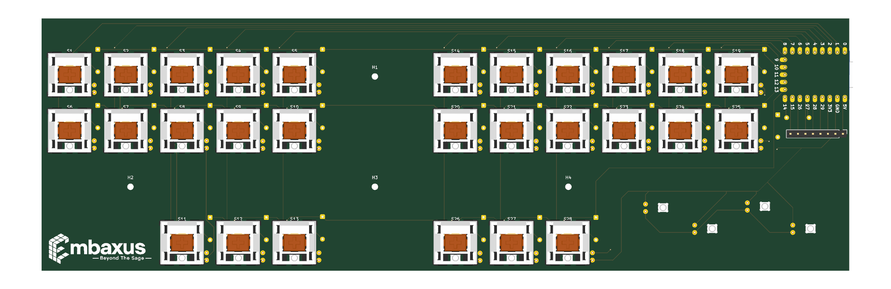
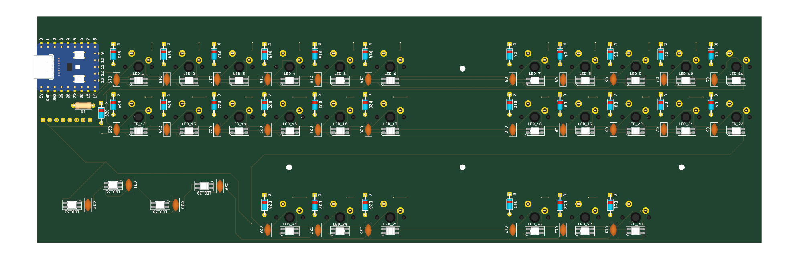

# Embaxus Steno Keyboard

A 28-key stenography keyboard PCB with per-key RGB, designed in KiCad 10.

- **MCU:** Waveshare RP2040-Zero (mounted on the back, USB-C at the right edge)
- **Switches:** 28× Cherry MX-compatible, PCB mount
- **Lighting:** 32× SK6812MINI-E reverse-mount RGB LEDs (28 under the keys + 4 standalone)
- **Board:** 2 layers, 273.84 × 85.73 mm, 1.6 mm FR-4

| Top | Bottom |
|---|---|
|  |  |

The full schematic is in [`docs/schematic.pdf`](docs/schematic.pdf).

## Repository layout

| Path | Contents |
|---|---|
| `hardware/` | KiCad 10 project: schematic, PCB, design rules (`.kicad_dru`) |
| `production/embaxus-steno-keyboard-gerbers.zip` | Ready-to-order Gerber + Excellon drill files |
| `production/gerber/` | The same fabrication files, unzipped |
| `docs/` | Schematic PDF and board renders |

## Electrical overview

### Key matrix (11 columns × 3 rows, COL2ROW)

Each switch has a 1N4148 diode: anode on the switch, cathode on the row.

| RP2040-Zero pin | Net |
|---|---|
| GP0 – GP10 | COLUMN0 – COLUMN10 |
| GP11 | ROW0 |
| GP12 | ROW1 |
| GP13 | ROW2 (thumb row) |
| GP14 | LED data (through R1) |

### RGB LEDs

- Data path: **GP14 → R1 (330 Ω) → LED_1 → LED_2 → … → LED_32**. The LED numbers follow the chain order.
- **LED_1 supply diode (D29, 1N4148):** LED_1 is powered from 5 V through D29, so it runs at about 4.3 V. Its input threshold (0.7 × VDD) drops to about 3.0 V, so the RP2040's 3.3 V data is read reliably. LED_1 re-drives the data at full level for the rest of the chain.
- **Decoupling:** one 100 nF capacitor per LED, placed next to its LED.
- **Current:** at full white the 32 LEDs draw roughly 1.15 A (12 mA per colour channel), more than USB normally supplies. **Limit brightness in firmware.**

### Expansion header J1 (unpopulated, 2.54 mm)

| J1 pin | Signal |
|---|---|
| 1 | +5V |
| 2 | GND |
| 3 | 3V3 |
| 4 | GP29 |
| 5 | GP28 |
| 6 | GP27 |
| 7 | GP26 |
| 8 | GP15 |

Pins 1 and 2 are next to each other; take care not to bridge 5 V to GND when soldering wires.

## Bill of materials

| Qty | Ref | Part | Footprint |
|---|---|---|---|
| 28 | S1–S28 | MX-compatible switch | MX PCB 1.00u |
| 29 | D1–D29 | 1N4148 | DO-35, 7.62 mm pitch |
| 32 | LED_1–LED_32 | SK6812MINI-E | Reverse mount, 3.2 × 2.8 mm |
| 32 | C1–C32 | 100 nF ceramic | Disc, 2.5 mm pitch |
| 1 | U2 | RP2040-Zero | Through-hole module |
| 1 | R1 | 330 Ω, 1/4 W | Axial, 7.62 mm pitch |
| 1 | J1 | 1×8 pin header (optional) | 2.54 mm |
| 4 | H1–H4 | M2 mounting holes | 2.2 mm NPTH |

## Fabrication

Upload `production/embaxus-steno-keyboard-gerbers.zip` to your PCB fab. Settings used:

- 2 layers, 1.6 mm, 1 oz copper, HASL (lead free)
- Min track / spacing: 0.2 mm (use the fab's 6/6 mil option)
- Min hole: 0.3 mm (vias 0.3 mm drill / 0.6 mm pad)
- The board has **32 internal rectangular cutouts** for the reverse-mount LEDs on the Edge.Cuts layer. Some LED pads are about 0.25 mm from these cutouts; this comes from KiCad's standard SK6812MINI-E footprint and is allowed for LED pads only by a custom rule in `hardware/embaxus-steno-keyboard.kicad_dru`.

## Assembly notes

- **SK6812MINI-E LEDs are moisture sensitive (MSL 5a).** Solder them within about 24 h of opening the bag, or bake at 70 °C for 12 h first.
- The LEDs are **reverse mount**: the body goes up through the cutout, and the four legs are soldered to the pads on the back. Do not cut the legs.
- Handle the LEDs by their sides; the silicone lens is soft.
- If R1 is not fitted, bridge its two holes with a wire. Otherwise no data reaches the LEDs.

## Firmware notes (QMK / Vial)

- Diode direction: `COL2ROW`.
- Matrix: columns GP0–GP10, rows GP11–GP13.
- RGB: WS2812 driver on GP14, 32 LEDs, chain order LED_1 → LED_32 as on the silkscreen. LED_29–LED_32 are not under keys.
- Set a brightness cap (for example `RGB_MATRIX_MAXIMUM_BRIGHTNESS` around 100–120) to stay within USB current.

## Editing the design

The project opens in **KiCad 10**. Symbols and footprints are embedded in the schematic and PCB files. To edit library parts, install the [ScottoKeebs KiCad libraries](https://github.com/joe-scotto/scottokeebs) used for the switch, MCU and diode placeholders.

## License

No license has been chosen yet.
